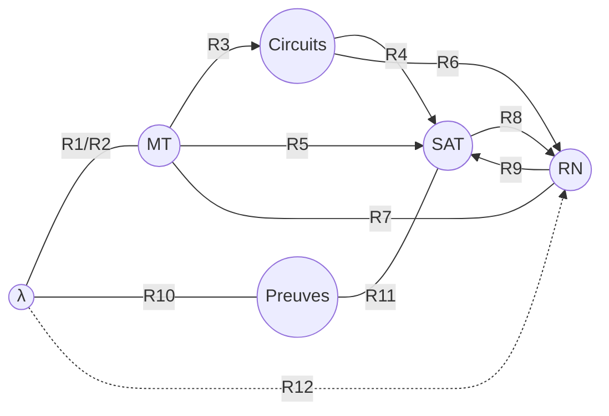

# NCE — Carte des relations entre modèles

Nœuds : **λ** (lambda-calcul), **MT** (machines de Turing), **C** (circuits booléens et à seuil, objet pivot), **SAT** (problème de satisfaisabilité sur CNF ou circuits), **RN** (réseaux neuronaux), **P** (systèmes de preuve).

Les surcoûts indiqués sont ceux de la littérature, avec le statut **CONNU (à vérifier)** tant que l'audit L-01 n'est pas fait. Les colonnes vides sont précisément ce que le programme doit mesurer.

| # | Source → cible | Traduction | Résultat | Surcoût (connu) | Ressource non mesurée | Statut |
|---|---|---|---|---|---|---|
| R1 | λ → MT | Machines abstraites (SECD, Krivine) | Turing 1937 ; Landin 1964 ; Krivine 2007 | Polynomial pour la réduction gauche-externe (Accattoli et Dal Lago 2016) | Partage, mémoire des fermetures | CONNU (à vérifier) |
| R2 | MT → λ | Encodage des configurations en termes | Turing 1937 ; Kleene 1936 | Polynomial | Taille des termes | CONNU (à vérifier) |
| R3 | MT → C | Déroulement en circuit | Pippenger et Fischer 1979 | Taille O(t log t) pour un temps t | Largeur arborescente du circuit | CONNU (à vérifier) |
| R4 | C → SAT | Tseitin | Tseitin 1968 | Linéaire en taille | Préservation de la largeur : **INV-01** | CONNU (à vérifier) / OUVERT pour la largeur |
| R5 | MT → SAT | Tableau de Cook-Levin | Cook 1971 ; Levin 1973 | Taille polynomiale (O(t²) pour le tableau naïf) | Largeur en fonction de l'espace : **H-B1** | CONNU (à vérifier) / CONJECTURE |
| R6 | C → RN | Porte → neurone à seuil | McCulloch et Pitts 1943 | Linéaire | Bits de poids (Håstad 1994) ; largeur : **H-B3** | CONNU (à vérifier) |
| R7 | RN (récurrent) → MT et MT → RN | Simulation | Siegelmann et Sontag 1995 | Temps réel à facteur près, poids rationnels | Précision : poids réels → au-delà de Turing (1994) | CONNU (à vérifier) |
| R8 | SAT → RN | Énergie d'Ising/Hopfield ; solveurs appris | Hopfield et Tank 1985 ; Lucas 2014 ; Selsam et al. 2019 | Encodage polynomial ; aucune garantie de résolution | Coût de recherche réel | CONNU (à vérifier) |
| R9 | RN → SAT | Vérification de réseaux | Katz et al. 2017 (NP-complet, ReLU) | Polynomial pour l'encodage | Largeur après encodage | CONNU (à vérifier) |
| R10 | λ (typé) ↔ P | Curry-Howard | Howard 1980 | — | Lien avec la résolution et CDCL : **T9b** | CONNU (à vérifier) |
| R11 | P ↔ SAT | CDCL et résolution | Pipatsrisawat et Darwiche 2011 | CDCL p-simule la résolution (sous hypothèses) | — | CONNU (à vérifier) |
| R12 | λ → RN | Représentations tensorielles et symboliques | Smolensky 1990 ; Weiss et al. 2021 (RASP) | Peu quantifié | Taille, précision, profondeur : **T8** | OUVERT |
| R13 | Transformer ↔ MT ou C | Turing-complétude ; borne TC⁰ | Pérez et al. 2019 ; Merrill et Sabharwal 2023 | Selon les hypothèses de précision | Précision comme ressource : **INV-02** | CONNU (à vérifier) |

