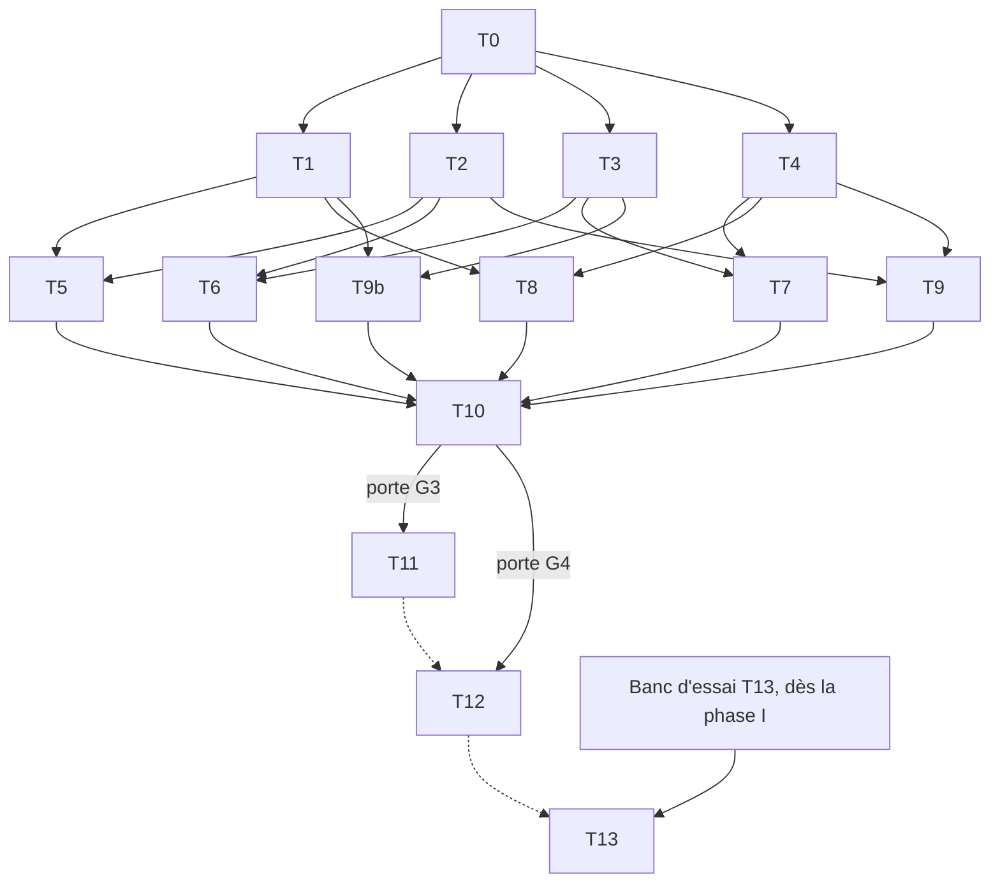

# NCE — Audit scientifique initial (INITIALIZE)

Programme dirigé par Oussama Ghorbel · orchestration : Claude · statut du document : v0.1, avant la porte de décision G0.

Ce document répond aux points 1 à 10 du « format de réponse initial » du prompt maître. Il ne rédige aucun tome.

Convention : toute référence porte le statut **CONNU (à vérifier)** tant que l'audit bibliographique L-01 ne l'a pas confrontée à la source primaire. Aucune référence n'a été inventée. Toutefois, les détails bibliographiques (volume, pages) restent à contrôler.

---

## 1. Évaluation scientifique de NCE

### 1.1 Ce qui est déjà établi, et qui change la nature de la question

- **Équivalence de calculabilité.** Le lambda-calcul et les machines de Turing calculent les mêmes fonctions : Turing (1937), *Computability and λ-definability*, et Kleene (1936). Un réseau récurrent à poids rationnels simule une machine de Turing en temps réel à facteur près : Siegelmann et Sontag (1995). La question « ces modèles sont-ils équivalents ? » est donc **résolue** au niveau de la calculabilité.
- **SAT n'est pas un modèle de calcul.** C'est un *problème de décision*. L'objet qui joue le rôle de « modèle » est le **circuit booléen** ou le **système de contraintes** qui représente un calcul *borné*. Le théorème de Cook-Levin (Cook 1971, Levin 1973) relie les deux. Le programme doit corriger cette erreur de catégorie dès le départ (voir FAILURES.md, F-001).
- **Équivalence polynomiale.** Les traductions standard entre ces formalismes ont un surcoût polynomial. Le lambda-calcul a un modèle de coût « raisonnable » : la réduction gauche-externe est invariante d'après Accattoli et Dal Lago (2016).

**Conséquence.** La seule question non triviale porte sur les **ressources** et la **structure** : quels coûts fins, quels paramètres structurels, quelle précision et quel partage sont préservés, perdus ou créés par chaque traduction. C'est là que NCE peut produire du neuf.

### 1.2 Le risque fondamental : les traductions ne rendent pas faciles les problèmes difficiles

Les traductions sont calculables en temps polynomial. Une traduction ne peut donc pas transformer un problème NP-difficile en problème facile *dans le pire cas*, sauf si P = NP. Toute affirmation de « réduction de complexité » doit viser l'une des cibles suivantes :

- une **classe d'instances structurées**, par exemple de largeur arborescente bornée ;
- un **paramètre**, au sens de la complexité paramétrée ;
- des **constantes** ou la **taille de représentation** ;
- un **cas moyen** sur une distribution explicitement définie.

Les méthodes connues pour obtenir des bornes inférieures générales se heurtent à trois barrières :

- la relativisation (Baker, Gill et Solovay 1975) ;
- les preuves naturelles (Razborov et Rudich 1997) ;
- l'algébrisation (Aaronson et Wigderson 2009).

Une « loi de complexité » générale (hypothèse E) qui prétendrait séparer des classes devrait contourner ces barrières. Le reviewer hostile doit vérifier ce point en priorité.

### 1.3 Opportunités réelles

1. **Traductions annotées en ressources.** Il n'existe pas, à notre connaissance (à vérifier), de cadre *unique* qui mesure avec le même vocabulaire les surcoûts de toutes les traductions entre λ, MT, circuits/CNF et réseaux. Ces ressources sont le temps, la taille, la profondeur, la largeur structurelle, les bits de précision et le partage.
2. **La précision, ressource cachée.** Avec des poids réels arbitraires, un réseau dépasse la machine de Turing (Siegelmann et Sontag 1994). La précision est donc une ressource de premier ordre, souvent omise. Les bornes sur la taille des poids des portes à seuil (Håstad 1994) en donnent une première mesure.
3. **Le partage, candidat invariant.** Le partage de sous-termes en λ (réduction optimale : Lamping 1990, Asperti et Mairson 1998), la réutilisation de sous-circuits et le partage de paramètres dans les réseaux sont-ils un même invariant ? La question est profonde et, à notre connaissance, peu formalisée transversalement.
4. **La largeur structurelle, invariant mesurable.** La largeur arborescente (treewidth) gouverne la complexité paramétrée de SAT. On peut tester si elle survit à la chaîne MT → circuit → CNF → réseau à seuil.

### 1.4 Faiblesses de la formulation actuelle

- « Équivalence computationnelle » n'est pas défini. Il faut une définition formelle de la **traduction à ressources**, par exemple : une traduction T est (f, g)-bornée si |T(x)| ≤ f(|x|), si elle a un surcoût d'exécution g et si elle préserve la sémantique. À partir de là, on peut définir une **famille** de relations : ≡_lin, ≡_poly, ≡_param(k).
- **Conflit de nom.** Wolfram (2002, *A New Kind of Science*) a formulé un « Principe d'équivalence computationnelle ». Le nom NCE prête à confusion avec ce principe, que la communauté critique. Il faut s'en distinguer explicitement dans le Tome 0.
- Les hypothèses A à E sont trop larges pour être réfutables en l'état. Elles sont décomposées en sous-hypothèses testables dans HYPOTHESES.md.

---

## 2. Évaluation critique du programme de 14 tomes

| Problème | Tomes concernés | Recommandation |
|---|---|---|
| SAT est traité comme un modèle de calcul | T3, T6, T7 | Le Tome 3 devient « Circuits booléens, contraintes et SAT ». Le circuit est l'objet modèle, SAT le problème associé. |
| Il manque un pivot commun | Phase II | Les **circuits** (booléens et à seuil) deviennent la *langue pivot*. Chaque modèle y est relié, ce qui rend les invariants comparables. Simulation MT → circuits : Pippenger et Fischer (1979). |
| Il manque une paire | Phase II | 4 modèles donnent 6 paires, mais le programme n'en traite que 5. **λ ↔ SAT/preuves** manque. Or Curry-Howard (Howard 1980) et la complexité des preuves (résolution, dont CDCL dépend) en font une arête majeure. Ajouter le Tome 9b. |
| Fondation manquante | Phase I | Il faut une théorie des **simulations et réductions à ressources**, préalable strict à toute mesure de coût. Elle est placée dans le Tome 0 (partie formelle). |
| Les réseaux modernes sont absents | T4, T9 | Ajouter les transformers : Turing-complétude sous hypothèses (Pérez, Marinković et Barceló 2019) et limites à précision logarithmique (Merrill et Sabharwal 2023). |
| La complexité des preuves est absente | T3, T7 | La résolution, puissance de CDCL (Pipatsrisawat et Darwiche 2011), est indispensable pour distinguer vérification et recherche. |
| Tome 11 prématuré | T11 | Le rendre **conditionnel** à la porte G3 : il n'est écrit que si le Tome 10 établit des invariants non triviaux. Il peut aussi être fusionné avec le Tome 10. |
| Tome 12 (NCSM) prématuré | T12 | Il est **conditionnel** (porte G4). Le risque est de protéger une architecture décidée d'avance. |
| Tome 13 trop tardif | T13 | Le **banc d'essai** des transformations est construit dès la Phase I. Ainsi, chaque affirmation a son test, et seul le livre reste en fin de parcours. |

## 3. Architecture révisée

**PHASE I — Fondations**

- **T0** Programme NCE et cadre formel des traductions à ressources : définitions, protocole, cartographie.
- **T1** Lambda-calcul : structure fonctionnelle, réduction, partage, modèles de coût.
- **T2** Machines de Turing : états, mémoire, simulations, temps et espace.
- **T3** Circuits booléens, contraintes et SAT : circuits, CNF, Tseitin, Cook-Levin, résolution, CDCL.
- **T4** Réseaux neuronaux : portes à seuil, ReLU, réseaux récurrents, transformers ; précision, profondeur, largeur.

**PHASE II — Relations (pivot : circuits)**

- **T5** λ ↔ MT : machines abstraites (SECD, Krivine), invariance des coûts.
- **T6** MT ↔ circuits ↔ SAT : tableaux, Pippenger-Fischer, model checking borné.
- **T7** circuits/SAT ↔ réseaux : circuits à seuil, vérification de réseaux par SAT ou MILP, solveurs neuronaux.
- **T8** λ ↔ réseaux : représentation des termes et des liaisons, réduction neuronale, coût.
- **T9** MT ↔ réseaux : Siegelmann-Sontag, précision, mémoire externe, transformers.
- **T9b (nouveau)** λ ↔ SAT/preuves : Curry-Howard, complexité des preuves.

**PHASE III — Synthèse**

- **T10** Invariants computationnels : tome central.
- **T11** Théorie NCE, *conditionnel à G3*.

**PHASE IV — Architecture et application**

- **T12** NCSM, *conditionnel à G4*.
- **T13** Transformations de problèmes. Le banc d'essai est construit **dès le début** ; le livre vient à la fin.

**Ouvrage final** : *NCE — The Architecture of Computation*, conditionnel à G5.

## 4. Graphe de dépendances

**Dépendances strictes**, où le résultat est mathématiquement requis :

- la définition des traductions à ressources du T0 conditionne **tous** les résultats de coût ;
- les bornes de taille et de largeur de Tseitin et Cook-Levin du T6 conditionnent les encodages neuronaux du T7 ;
- le modèle de coût du λ-calcul du T1 conditionne les comparaisons quantitatives du T5 et du T8.

**Dépendances conceptuelles**, où le résultat aide sans être nécessaire : T1 → T9 et T5 → T8.

## 5. Risques bibliographiques et de nouveauté

| Axe | Ce qui est déjà connu (à vérifier) | Risque de « redécouverte » |
|---|---|---|
| λ ↔ MT | Équivalence (Turing 1937) ; SECD (Landin 1964) ; machine de Krivine (2007) ; invariance des coûts (Accattoli et Dal Lago 2016) | **Élevé** |
| MT ↔ SAT | Cook-Levin ; Tseitin (1968) ; simulation par circuits (Pippenger et Fischer 1979) ; model checking borné (Biere et al. 1999) ; planification par SAT (Kautz et Selman 1992) | **Très élevé** |
| SAT ↔ réseaux | McCulloch et Pitts (1943) ; Hopfield et Tank (1985) ; formulations d'Ising (Lucas 2014) ; NeuroSAT (Selsam et al. 2019) ; vérification de réseaux NP-complète (Reluplex, Katz et al. 2017) | **Élevé** (domaine encombré) |
| MT ↔ réseaux | Siegelmann et Sontag (1994, 1995) ; NTM et DNC (Graves et al. 2014, 2016) ; Turing-complétude des transformers (Pérez et al. 2019) ; limites TC⁰ (Merrill et Sabharwal 2023) | **Élevé** |
| λ ↔ réseaux | Représentations tensorielles (Smolensky 1990) ; RASP (Weiss et al. 2021) | **Moyen** : moins exploré |
| Circuits ↔ réseaux | Circuits à seuil de profondeur bornée (Hajnal et al. 1993) ; taille des poids (Håstad 1994) ; bénéfices de la profondeur (Telgarsky 2016) | **Élevé** |
| « Qu'est-ce qu'un algorithme » | Machines à états abstraits (Gurevich 2000) ; modèle BSS sur les réels (Blum, Shub et Smale 1989) | **Moyen** : antériorité directe pour l'« architecture unifiée » |
| Bornes inférieures générales | Barrières de relativisation, de preuves naturelles et d'algébrisation | **Risque d'erreur**, pas seulement de redécouverte |

**Où la nouveauté est plausible :**

- (a) un cadre *uniforme* de traductions annotées en ressources, couvrant les six arêtes ;
- (b) des théorèmes *précis* de préservation d'invariants le long de **chaînes** de traductions, de bout en bout jusqu'aux réseaux ;
- (c) des compromis quantitatifs précision × profondeur × taille ;
- (d) un invariant de partage transversal.

Aucune de ces nouveautés n'est revendiquée avant l'audit de priorité.

## 6. Opportunités classées

Les évaluations sont qualitatives (élevée / moyenne / faible), sans fausse précision numérique.

| # | Opportunité | Profondeur | Faisabilité | Nouveauté potentielle | Impact | Expérimentable | Risque principal |
|---|---|---|---|---|---|---|---|
| O1 | Cadre formel des traductions à ressources et carte des surcoûts | moyenne | **élevée** | moyenne | fondation de tout | oui | être une simple reformulation |
| O2 | Préservation de la largeur structurelle le long de MT → circuit → CNF → réseau à seuil, et son pouvoir prédictif sur le coût de résolution | moyenne | **élevée** | moyenne (les maillons sont en partie connus, la chaîne complète moins) | moyen | **oui, peu coûteux** | résultats déjà folkloriques |
| O3 | Précision comme ressource : compromis bits × profondeur × taille | élevée | moyenne | moyenne à élevée | élevé | oui | bornes déjà connues pour les portes à seuil |
| O4 | Invariant de partage (λ, circuits, partage de poids) | **élevée** | faible à moyenne | **élevée** | élevé | partiellement | formalisation difficile |
| O5 | Transformations à avantage mesurable sur des classes structurées | moyenne | moyenne | variable | **très élevé** | oui | références de comparaison trop faibles |
| O6 | Lois quantitatives de ressources (hypothèse E) | élevée | faible | incertaine | élevé | oui | fausse certitude empirique, barrières |
| O7 | Architecture NCSM | — | **faible aujourd'hui** | incertaine | incertain | plus tard | architecture non motivée |

## 7. Registres initialisés

Voir `01_LEDGERS/` (HYPOTHESES, THEOREMS, EXPERIMENTS, LITERATURE, FAILURES, ARCHITECTURES) et `00_PROGRAM/RELATIONSHIP_MAP.md`.

## 8. Première investigation recommandée

**INV-00, courte et préalable stricte.** Définir formellement la *traduction à ressources* et les relations d'équivalence indexées par le surcoût. Il s'agit d'un document de définitions, pas d'un livre.

**INV-01, première vraie investigation.** *La largeur structurelle est-elle un invariant des traductions entre modèles, et prédit-elle le coût de résolution ?*

Raisons de ce choix :

1. Elle teste directement l'hypothèse B (invariants) sous une forme **réfutable**.
2. Elle s'appuie sur des résultats connus, en particulier la complexité paramétrée de SAT par largeur arborescente. Le cadre INV-00 se vérifie donc d'abord en **retrouvant** ce qui est connu.
3. L'extension jusqu'aux réseaux à seuil et jusqu'aux réseaux *entraînés* est moins explorée. C'est là que se trouve la nouveauté possible.
4. Les expériences sont **peu coûteuses** : Python, un solveur CDCL et des heuristiques de largeur arborescente. Elles sont reproductibles avec des graines fixées.
5. Elle ne présuppose rien sur l'architecture finale.

Ce qui réfuterait l'investigation :

- un explosion de la largeur sous une traduction standard ;
- ou l'absence de corrélation entre la largeur et le coût de résolution une fois la taille contrôlée.

## 9. Feuille de route

Voir `00_PROGRAM/RESEARCH_ROADMAP.md` pour les jalons M0 à M8 et les portes de décision G0 à G5.

## 10. Actions immédiates

1. **Porte G0, votre décision.** Approuver ou modifier l'architecture révisée de la section 3 et le choix INV-00 puis INV-01.
2. **Audit L-01.** Vérifier chaque référence de LITERATURE.md sur source primaire, par recherche web ciblée, et faire passer « CONNU (à vérifier) » à « CONNU ».
3. **Banc d'essai.** Créer `07_CODE/benchmarks/` : générateurs de calculs bornés, encodeurs CNF et réseau à seuil, mesure de largeur, solveur.
4. **Nom.** Trancher la distinction avec le « Principe d'équivalence computationnelle » de Wolfram dans le Tome 0, ou renommer.
